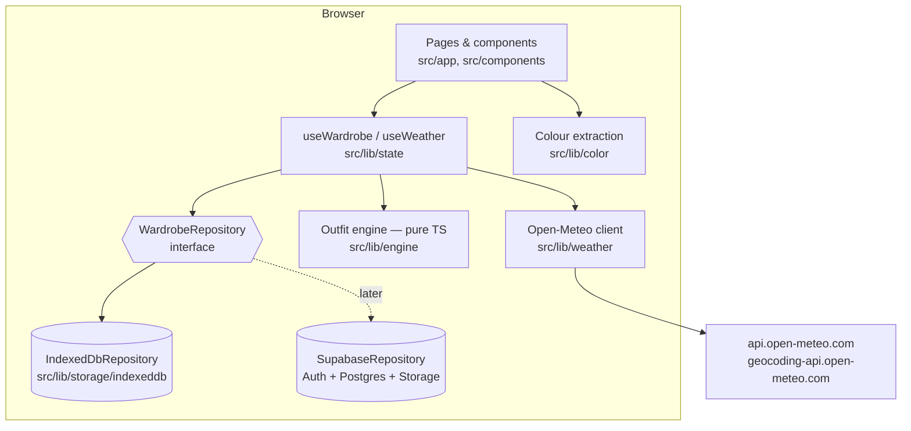
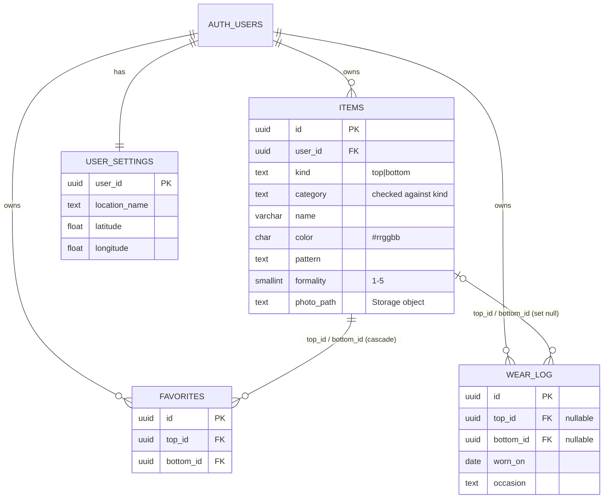

# Architecture

Rack is a **client-only modular monolith**. Next.js renders the pages and the browser does the rest: storage, colour extraction and outfit scoring. Network calls go only to Open-Meteo.

## Layers

| Layer | Folder | May import |
|---|---|---|
| Presentation | `src/app`, `src/components` | state, engine (types + pure fns), color, weather (place search + formatting), `storage` (interface + factory only) |
| State | `src/lib/state` | storage interface, engine, weather |
| Domain | `src/lib/engine`, `src/lib/color` | `src/lib/domain` (types) only — no DOM, no IO |
| Infrastructure | `src/lib/storage/*`, `src/lib/weather` | domain types |

The storage factory (`src/lib/storage/index.ts`) is the only file that names a concrete repository. A unit test (AC-18) fails if any UI file imports `storage/indexeddb`.

## Data flow: "what should I wear today?"

1. `RepositoryProvider` creates the repository once; `useWardrobe` loads items, favourites and the wear log into React state.
2. `useWeather` reads the saved location from settings, then the per-device cached forecast in `localStorage` (fresh for < 60 min) or fetches Open-Meteo.
3. `generateOutfits(tops, bottoms, { occasion, weather, wearLog, today })` returns scored outfits with reasons. It is memoised on its inputs.
4. Writes (favourite, wore it) go to the repository and then refresh the state slice.

## ADRs

### ADR-1 Client-only Next.js with no API routes
- **Context:** No accounts, no server storage, no keys in v1.
- **Decision:** All pages are client components over static shells. No route handlers.
- **Consequences:** It can be hosted on any static host. The Supabase swap needs no server code either, because supabase-js runs in the browser with RLS.

### ADR-2 Repository interface, async everywhere, photo access by URL
- **Decision:** Every repository method returns a Promise. Photos are reached through `getPhotoUrl(photoId)`: IndexedDB returns a cached `blob:` object URL, Supabase would return a signed URL. Items hold a `photoId` that is an IDB key today and a Storage path tomorrow.
- **Why:** The UI never touches a Blob store, so the swap is a single factory change.

### ADR-3 Raw IndexedDB through `idb` (≈1 kB) instead of Dexie
- **Decision:** Use `idb` (a promise wrapper) with stores `items`, `photos`, `favorites`, `wear`, `settings`.
- **Why:** The schema is tiny and `idb` keeps the bundle small. `fake-indexeddb` lets tests run the real repository code.

### ADR-4 Rule-based engine as pure functions
- **Decision:** `evaluatePair` returns `{ ok, score, reasons[], rejections[] }`. Hard rules reject a pair; soft rules add or subtract points. Weights are constants in `rules.ts`.
- **Why:** The results can be explained to the user (reasons are shown as lookbook captions), are deterministic, and are cheap to unit-test (NFR-1, NFR-4).

### ADR-5 Dominant colour by background-subtracted, centre-weighted histogram
- **Decision:** Downsample the image to 64×64 on a canvas. Estimate the background from border pixels, drop pixels close to it, weight the rest by closeness to the centre, and take the heaviest bin of a 4-bit-per-channel histogram. Return the mean colour of that bin.
- **Why:** Garment photos are usually centred on a plain backdrop. This approach is deterministic and fast, and the user can override the result.

### ADR-6 Weather cache per device, outside the repository
- **Decision:** The forecast is stored with `fetchedAt` in `localStorage` (`rack:forecast`) and reused for 60 min when the location key matches. Only the chosen *location* is a synced setting.
- **Why:** A forecast is per device and short-lived, so it should never sync to Supabase. Keeping it out of the repository also means a fetch doesn't re-render the whole wardrobe context, and a failed cache write can't turn a good forecast into an error. The freshness check is a pure function (`freshCache`), so AC-16 stays unit-testable.

## Data model (Supabase target, mirrors the IndexedDB stores)

Index choices: `(user_id, created_at desc)` for the closet listing and `(user_id, worn_on desc)` for the diary, plus every foreign key column so cascades and set-null updates don't scan whole tables. The weather cache is in browser `localStorage` under either backend because it is per device and short-lived.
